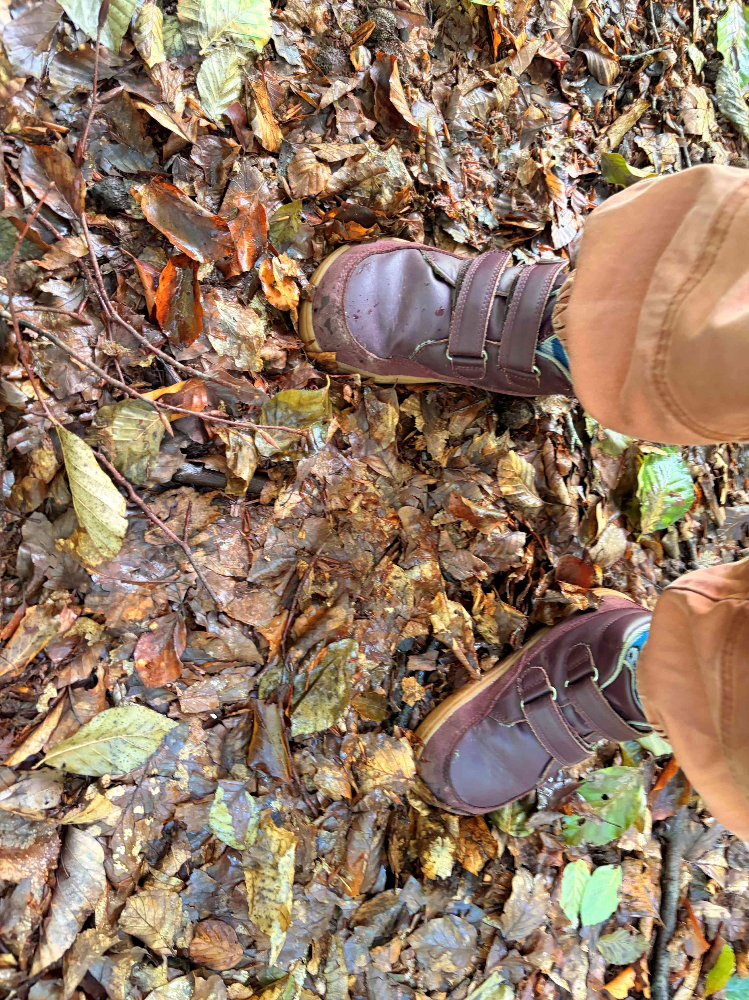

Hello, I'm Nick. 👋

I'm a Product Manager at NHS England, working on improving services for Patients and Staff. Before that I spent 15 years working in digital agencies (R/GA, Tribal, Engine), Financial Services (Runpath, Experian, Open Baning) and running a startup of my own (AnMa).

Moving into the public sector has changed how I think about product, in line with that I'm starting to <a href="https://roadmap-for-modern-digital-government.campaign.gov.uk/transparency/working-in-the-open/" target="_blank" rel="noopener noreferrer">work in the open</a>. This site is where I write it down: <a href="https://medium.com/@jukesie/the-why-of-weeknotes-c1cd98967842" target="_blank" rel="noopener noreferrer">weeknotes</a> on what happened and what I learned, and longer pieces when something requires deeper thinking.

The name of the site comes from the idiom, 'how do you eat an elephant? One bite at a time'. The NHS has many big, complex problems and it's my job to help break these down into bitesized, value-focused pieces. 

I hope you find it useful, and mildly amusing (I share some of my attempts at parenting too).

